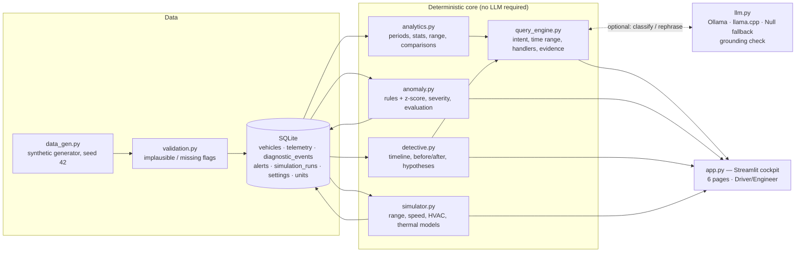
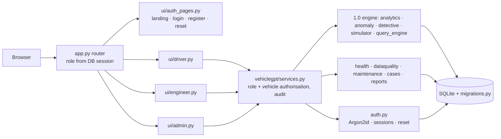

# Architecture

## Query pipeline
1. **Interpret** — rule-based classifier (`query_engine.classify`) maps the question to one of: `range_change`, `before_warning`,
   `unusual_events`, `compare_energy`, `repeated_dtc`, `metric_stat`, `distance`, `alerts_summary`, `unsupported`, `unknown`.
   Unknown questions go to the local LLM classifier if one is available.
2. **Resolve** — `parse_period` handles `yesterday`, `today`, `this/last week`, `last N days`, ISO dates, `Sep 19`. Because the data
   is historical, “now” = midnight after the last record (2026-09-22 00:00).
3. **Retrieve & compute** — SQL reads + pandas calculations in `analytics.py`; invalid readings are excluded and reported.
4. **Explain** — the same facts render as a Driver sentence and an Engineer summary. The LLM may rephrase; output with any
   ungrounded number is rejected.
5. **Return** — facts (with kind), evidence records (ids, timestamps, source refs), limitations, safety notes, chart spec.

Questions about channels that don't exist (brakes, oil, tread…) return an explicit limitation — never an invented value.

## Data model (SQLite)
* `telemetry` — 10-min samples: state, speed, SOC, battery/motor/ambient temps, power, interval distance & energy, odometer,
  tyre pressure, `valid`, `validity_note`, `source_ref`, `synthetic`. Indexed on `(vehicle_id, ts)` and `trip_id`.
* `diagnostic_events` — `SIM-*` codes with subsystem, reported level and source ref.
* `alerts` — rule id, severity, observed/threshold/baseline, anomaly score, evidence JSON, next step, acknowledgment
  (preserved across re-runs via a fingerprint).
* `simulation_runs` — baseline, params and result JSON, labelled `HYPOTHETICAL ESTIMATE`.
* `units`, `vehicles`, `settings` (thresholds).

## Severity rules (demonstration thresholds; editable in Settings)
| Rule | Trigger | Severity |
|---|---|---|
| R-BATT-TEMP | battery temp episode ≥ 40 / 43 / 46 °C | Low / Medium / High |
| R-MOTOR-ROC | motor temp rise ≥ 8 °C per 10 min | Medium; High if peak ≥ 85 °C |
| R-CONS-DEV | daily kWh/100 km ≥ 10 % / 20 % above prior 7-day mean (z-score reported) | Low / Medium |
| R-DTC-REPEAT | same code ≥ 3× within 7 days | Medium |
| R-DTC-SINGLE | isolated warning / info DTC | Low / Informational |
| R-DATA-GAP | logging gap > 30 min | Low |
| R-DATA-MISS | NULL readings (≥ 3 consecutive → Low) | Informational / Low |
| R-DATA-IMPL | physically implausible reading | Medium |

No rule asserts that a component will fail.

## Simulation models
* `range = usable_kWh ÷ (kWh_per_100km ÷ 100)`; miles = km ÷ 1.609344
* Speed: `factor = 0.6 + 0.4 × (v_new/v_base)²` (40 % aero share assumption)
* HVAC: `+0.12 kWh/100 km per °C` away from 21 °C
* Thermal: `T_peak = T_amb + (T_peak0 − T_amb0) × (1 − cooling_improvement)` (steady state, first order)

## Synthetic dataset (21 days, 3 006 samples, 8 DTCs)
Injected, labelled scenarios: highway day (09-11), DC fast-charge battery overheating (09-11 13:00–13:40), logger gap
(09-08 03:00–06:00), implausible 151 °C spike (09-13 10:20), SOC dropout (09-14 09:00–10:00), cold week with low tyre pressure
(09-15..21), repeated `SIM-TPMS-L01` (×4), coolant-pump fault with rapid motor heating (09-19 10:00–10:40), and an isolated
infotainment timeout with no supporting telemetry (insufficient-evidence case).

## VehicleGPT 2.0 additions

* Fleet: SYN-EV-001 (1.0 scenarios), SYN-EV-002 (repeated fast-charge heating), SYN-EV-003 (data-quality faults).
* Alerts store `rule_version = <rule>@<v>/ruleset-<v>/th-<threshold hash>`.
* New rules: R-DATA-DUP, R-DATA-UNIT, R-DATA-FLAT, R-DATA-STALE; R-DATA-IMPL now grouped per episode.
