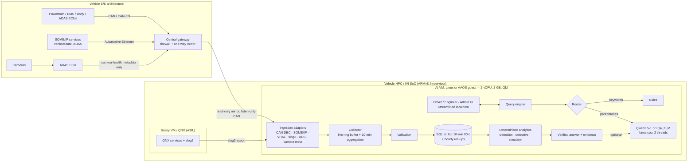

# VehicleGPT — Edge System Architecture (TELIPORT S4: Natural-Language Vehicle Information on an On-Device SLM)

This document answers the brief's *Expected Output* items. Every number below is **measured** and comes from a file in
`benchmarks/`. Anything we have not been able to measure is labelled **UNVERIFIED**.

## 1. High-level system architecture

| Layer | Component | Justification |
|---|---|---|
| Hardware (demo) | x86 laptop with 2 inference threads (measured); Raspberry Pi 5 / Graviton / QEMU arm64 (kit provided, **UNVERIFIED**) | Same Python/llama.cpp stack on all of them; ARM NEON kernels in llama.cpp |
| Hardware (vehicle) | IVI or zonal HPC SoC (Cortex-A55/A76/A78AE class), 2 dedicated cores, 2 GB partition | Matches the brief's 2 GB / 2× A5x budget; GPU/NPU optional |
| Hypervisor | Type-1 (QNX Hypervisor, Xen, or pKVM on AAOS) | Gives *spatial and temporal* isolation between the safety domain and the QM AI VM |
| AI-VM OS | Linux (Yocto/Debian) or Android Automotive guest | Linux: SocketCAN, systemd resource limits (`deploy/vehiclegpt.service`). AAOS: reads VHAL natively |
| Safety OS | QNX | Hosts safety-related services; only its slog2 logs are exported to the AI VM |
| Runtime | Python 3.11, SQLite, pandas/numpy, llama.cpp (GGUF) | No server database or GPU needed; single file store; quantised CPU inference |

## 2. Vehicle data collection strategy (`vehiclegpt/ingest/`)

| Source | Protocol / format | Adapter | What is extracted |
|---|---|---|---|
| Powertrain, BMS, body ECUs | CAN / CAN-FD, decoded with a **DBC** (`ingest/vehiclegpt.dbc`) via cantools; SocketCAN on Linux, `virtual` bus for demo | `can_source.py` | SOC, pack temperature, pack power, charge state, speed, motor temperature, odometer, ambient, tyre pressure |
| ADAS ECU | **CAN-FD** frame `ADAS_Status_FD` (16 B, extended ID) | `can_source.py` | feature (ACC/LKA), state, disengagement reason |
| Service-oriented ECUs | **SOME/IP** event notifications over UDP (AUTOSAR header, service 0x4C01 / event 0x8001) | `someip.py` | VehicleState snapshot |
| Android Automotive | **Vehicle HAL** property stream (AOSP VehicleProperty IDs, e.g. `PERF_VEHICLE_SPEED 0x11600207`) | `vhal.py` | speed, odometer, outside temperature, EV battery level → SOC, tyre pressure |
| QNX | **slog2info** text logs | `qnx_slog.py` | diagnostic codes with severity |
| Diagnostics | **UDS 0x19/0x02** ReadDTCInformation responses (DoIP/CAN-TP capture) | `diag_log.py` | DTC + status byte; unknown DTCs kept raw (never invented) |
| Cameras | camera-**health metadata only** (fps, blockage %) — no frames stored | `camera_meta.py` | sustained blockage → `camera_blocked` ADAS event |

**Normalisation.** Every adapter emits `Signal(ts, vehicle, canonical_name, value, unit, source, raw_ref)`. The collector
(`collector.py`) keeps a **live ring buffer** (last hour, in memory) and aggregates into **10-minute rows** (means for
continuous signals, last value for counters, mode for state). Each stored row carries its provenance
(`INGEST/can+someip+vhal/<bucket>`). Rows are idempotent per (vehicle, timestamp); timestamps from the future are
rejected; validation flags implausible values without changing them.

**Scenario recreation.** `ingest/replay.py` replays recorded drives (here, the synthetic 8-week fleet) through *all*
protocol paths into a bench vehicle `SYN-LAB-01`, end-to-end (encode → transmit → receive → decode → aggregate →
detect). `ingest/carla_bridge.py` maps a CARLA ego vehicle onto the same CAN frames (**UNVERIFIED** — CARLA not installed
here). Measured: a 4-hour replay (≈3,000 frames/records across CAN, SOME/IP, VHAL, slog2, UDS) runs in ~0.4 s
(~8,000 frames/s), and the motor coolant fault in the recording is **re-detected** from the ingested frames
(`tests/test_ingest.py::test_replay_end_to_end`).

## 3. SLM selection rationale (measured — `benchmarks/model_eval.md`)

The model is **not** used to compute numbers. It does two jobs: (1) route free-form questions to a verified analytics
handler and (2) optionally rephrase verified facts. Candidates were evaluated in isolated processes with **2 inference
threads** on a 40-question labelled set (half paraphrases that keyword rules miss):

| model | file MB | load ms | RSS after load MB | peak RSS MB | intent acc rules / LLM / rules-first / LLM-first | classify ms (median/p95) | explain ms | tok/s | grounded |
|---|---|---|---|---|---|---|---|---|---|
| Llama-3.2-1B-Instruct-Q4_K_M.gguf | 808 | 5892 | 1168 | 1179 | 0.675 / 0.4 / 0.725 / 0.75 | 361 / 683 | 7418 | 6.1 | 0.5 |
| qwen2.5-0.5b-instruct-q4_k_m.gguf | 491 | 3416 | 759 | 769 | 0.675 / 0.425 / 0.75 / 0.6 | 234 / 394 | 4143 | 9.7 | 0.5 |
| qwen2.5-1.5b-instruct-q4_k_m.gguf | 1117 | 5990 | 1449 | 1458 | 0.675 / 0.95 / 0.875 / 0.975 | 469 / 668 | 10118 | 4.4 | 0.5 |

**Choice: Qwen2.5-1.5B-Instruct, Q4_K_M (1.1 GB GGUF)** as the router: it is the only candidate that understands the
paraphrases (LLM-only accuracy far above the others), fits the 2 GB budget with headroom, and classifies a question in
well under a second. **Qwen2.5-0.5B** is the fallback for devices with < 2 GB free (≈0.77 GB peak), and the
**deterministic rules** keep every workflow working with no model at all. Free-text explanations take several seconds on
2 CPU threads, so they are produced **on demand** (“AI summary” button) and never block the answer; any explanation
containing a number not present in the verified facts is discarded (grounding check — about half are discarded, by design).

Routing policy: rules and model run on every question; precise keyword intents (ADAS, city/highway, largest drop,
data quality, “no such data” refusals) win when they fire, otherwise the model's label is used, with rules as fallback.
*Caveat:* this policy was tuned using the same evaluation set; accuracy on unseen phrasing will be lower.

## 4. Search and retrieval workflow

1. **Interpret** — router picks a handler (rules ∥ SLM) and `parse_period` resolves time (“yesterday”, “last two weeks”, dates).
2. **Retrieve** — parameterised SQL on indexed tables (`telemetry(vehicle_id, ts)`, `diagnostic_events`, `adas_events`, `alerts`).
3. **Compute** — deterministic pandas/numpy functions (range = usable kWh ÷ kWh/km, segmentation, rolling baselines, z-scores).
4. **Verify & cite** — every fact carries kind (measured / calculated / simulated / AI) and record ids + source refs.
5. **Explain** — role-specific template (driver vs engineer); optional grounded SLM rephrasing.
6. **Refuse** — missing channels (brakes, oil, tread…) return an explicit limitation, never a guess.

## 5. Historical data storage approach

| Tier | Where | Retention | Purpose |
|---|---|---|---|
| Live | in-memory ring buffer in the collector | last 60 min of raw signals | “what is it now”, live snapshot |
| Hot | SQLite `telemetry` (10-min rows), `diagnostic_events`, `adas_events`, `alerts` | 90 days raw (configurable) | all analytics and search |
| Cold | SQLite `telemetry_rollup_hourly` | indefinitely | long-term trends |

Measured footprint: 4.9 MB for 23,747 telemetry rows (165 vehicle-days, 7.9 weeks) ≈ 29 kB per vehicle-day → ≈ 2.7 MB for 90 days of raw data per vehicle, ≈ 1.8 MB/year of roll-ups. Pruning is explicit, writes roll-ups first and is recorded in `data_transformations`
(`ingest/retention.py`). The demo history spans **8 weeks** (2026-07-28 → 2026-09-21) for three vehicles.

## 6. Edge deployment architecture

* `deploy/Dockerfile` — multi-arch image (arm64/amd64), non-root, models mounted read-only.
* `deploy/run_edge.sh` — runs with `--cpus 2 --memory 2g --network none` (profile mode).
* `deploy/vehiclegpt.service` — systemd unit with `CPUAffinity`, `CPUQuota=200%`, `MemoryMax=2G`, `IPAddressDeny=any`.
* `deploy/pi_setup.sh`, `deploy/qemu_arm64.md` — Raspberry Pi 4/5, Graviton and QEMU arm64 instructions.
* Scaling path: Pi/VM → vehicle HPC uses the same image; a larger budget simply allows a bigger GGUF
  (`VEHICLEGPT_GGUF`) or more threads (`VEHICLEGPT_LLM_THREADS`). Multi-vehicle back-office use is supported by the
  same schema (fleet view in the Engineer portal).

## 7. User interaction design

* **Driver portal** — plain language, health score, warnings with next steps, efficiency, ADAS/event history,
  maintenance, reports. **Engineer portal** — structured query view, event detective, anomaly lab, cases, data quality,
  ingestion & retention, benchmarks. **Admin** — accounts and vehicle access.
* Answer first (fast, verified), AI summary on request; every element labelled LIVE / HISTORICAL / CALCULATED /
  SIMULATED / AI-GENERATED. A voice front-end (on-device ASR such as whisper.cpp) can feed the same `/ask` path (not built).

## 8. Safety isolation

VehicleGPT is a **QM, read-only consumer**:
1. **No transmit path** — the collector's CAN tap is `ReadOnlyBus` (send raises; tested). On hardware: CAN controller in
   **listen-only** mode, plus the gateway mirrors selected frames **one way** into the AI VM.
2. **Domain separation** — the AI VM runs under a type-1 hypervisor with fixed CPU/memory partitions; safety functions
   run in a separate (QNX/ASIL) domain the AI VM cannot address. Only logs and mirrored signals cross, via the gateway.
3. **Resource containment** — 2 cores / 2 GB caps (systemd/cgroups/container) so the AI cannot starve other partitions.
4. **No outbound network** — `IPAddressDeny=any` / `--network none`; SOME/IP endpoints bind to loopback in the demo.
5. **No actuation features** in the code base; recommendations are informational only.

## 9. Constraint compliance

Measured on an Intel i9 Mac (x86_64), inference limited to **2 threads**, `scripts/edge_profile.py`, 10 questions × 3 runs
(the brief's five examples + paraphrases). The 2 GB cap cannot be enforced by macOS, so peak RSS is measured; on Linux the
script enforces `RLIMIT_AS`.

| Constraint | Configuration | Result | Status |
|---|---|---|---|
| No cloud dependency | all | No outbound calls in core paths; `scripts/offline_check.py` blocks non-loopback sockets and passes; deploy kit uses `--network none` / `IPAddressDeny=any` | ✅ Met |
| ~2 GB RAM | Qwen2.5-1.5B router | peak RSS **1463 MB** (app + model) | ✅ Met (measured on x86) |
| | Qwen2.5-0.5B fallback | peak RSS **772 MB** | ✅ Met |
| | no model | peak RSS **167 MB** | ✅ Met |
| ~2 ARM A5x cores | 2 inference threads | runs with 2 threads on x86; ARM build/run kit in `deploy/` | ⚠️ **UNVERIFIED on ARM** — no ARM board, Docker or QEMU on the build machine |
| < 2 s for common queries | Qwen2.5-1.5B router | median **344 ms**, p95 429 ms, max 624 ms; **100%** under 2 s | ✅ Met on x86 · ⚠️ ARM unverified (expect 2–4× slower per thread; the 0.5B fallback or rules-only mode stay well inside 2 s) |
| | Qwen2.5-0.5B | median 208 ms, max 382 ms | ✅ |
| | rules only | median 16 ms, max 113 ms | ✅ |
| | optional AI summary | 12.5 s (1.5B) / 5.5 s (0.5B) | Off the critical path by design |
| History searchable for several weeks | 8-week dataset, 90-day raw retention + roll-ups | 8 weeks searchable now; storage estimate below | ✅ Met |
| Safety-critical functions isolated | read-only CAN tap, one-way gateway, hypervisor partition, resource caps | `ReadOnlyBus` send raises (tested); isolation design §8 | ✅ in software · ⚠️ hypervisor/gateway are design-level (no vehicle HW) |

